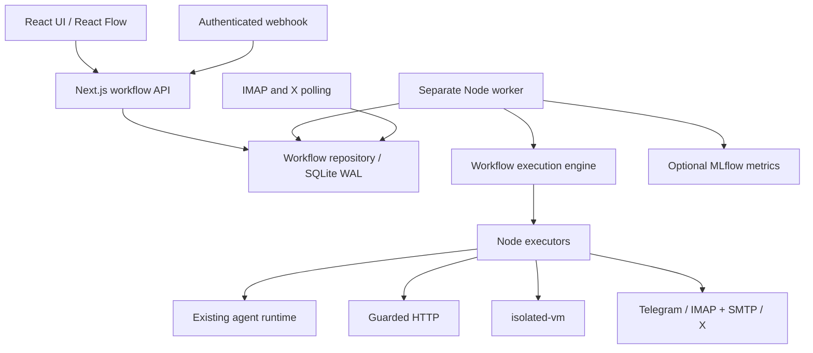

# m8m architecture

m8m combines reusable Gemini agents with a visual automation workspace. The original agent editor, playground, run APIs, resource storage, version history, and provider abstraction remain in place.

## Existing architecture, verified from code

Next.js 16.3.7 App Router and React 19.2.8 serve the UI and HTTP APIs. Tailwind v4, Radix/shadcn components, Monaco, and TanStack Query provide styling, forms, code editing, and server state. Zod schemas define agent/request validation. SQLite/libSQL (`@libsql/client`, local WAL or hosted Turso) and Drizzle store agents, agent_versions, resources, and runs. `lib/runtime/runAgent.ts` invokes Google through AI SDK 7, builds prompts, executes tools, validates JSON, optionally repairs output, and collects traces and token usage. Resources are injected as full text; there is no vector database or implemented RAG system.

Current workspaces require scrypt password login and owner-scoped sessions. Accounts own workflows, agents, encrypted integration credentials and Gemini keys. The SQL durable queue supports a separate worker or bounded serverless invocations. The LLM rate limiter is separate from this durable queue. See service-architecture.md for the shared-database deployment decision, free-deployment.md for Vercel/Turso operation, and delivery-checklist.md for acceptance evidence.

## Components and boundaries

This is a modular application with a separate worker process. A separate worker is justified by long-running jobs, polling, and recovery independent of web requests. Splitting every executor into a network microservice would add deployment and consistency complexity without serving this project's initial scale. Web and worker share domain modules, executor contracts, and a durable SQLite database.

### Modules

| Module | Responsibility |
|---|---|
| `lib/workflows/schema.ts` | Typed graphs, node/run/credential contracts |
| `catalog.ts` | Editor metadata and node categories |
| `graph.ts` | DAG validation, traversal, safe reference resolution |
| `store.ts` | Versioned schema setup, workflow revisions, credential encryption, queue transactions |
| `service.ts` | Agent/credential reference validation, secret redaction |
| `engine.ts` | Ordered execution, branch selection, bounded retries, progress, cancellation |
| `executors.ts` | Concrete AI, logic, HTTP, sandbox and integration executors |
| `triggers.ts` | IMAP/X cursors and event deduplication |
| `mlflow.ts` | Optional metrics-only tracking through the MLflow REST API |
| `scripts/workflow-worker.ts` | Queue consumer, lease heartbeat, polling, shutdown |
| `components/workflows` | Overview, React Flow editor, node renderer, credentials |
| `proxy.ts`, `adminAuth.ts` | Workspace authentication and same-origin mutation checks |

## Database

Existing tables are preserved. Workflow schema creation is additive and records version 1 in `workflow_migrations`. It can run repeatedly against existing data. Future schema changes must add transactional versioned migrations; `CREATE TABLE IF NOT EXISTS` alone does not alter existing columns.

| Table | Fields and invariants |
|---|---|
| `workflows` | ID, name, description, draft graph JSON, revision, active_revision, hashed webhook key, timestamps |
| `workflow_versions` | Immutable graph snapshot, unique(workflow_id, revision) |
| `workflow_runs` | Snapshot/revision, input, output, step states, terminal state, retry lineage, source, lease/worker ID, cancellation, unique(workflow_id, event_key) |
| `workflow_credentials` | Metadata plus AES-256-GCM encrypted values; API lists only metadata |
| `workflow_trigger_state` | Durable IMAP UIDVALIDITY/UID or X mention cursor; last polling error |
| `workflow_worker_health` | Worker heartbeat for UI and Docker health checks |

Saving increments a draft revision under a transaction with optimistic concurrency. A stale save receives 409. Activation pins the current validated revision. Editing an active workflow does not change incoming automatic executions until it is reactivated. Runs retain their own graph snapshot. Restore creates a new draft revision. Credential deletion is refused while a draft or active workflow references it. Workflow deletion is refused while runs are queued/running.

## Execution semantics

The first release supports directed acyclic graphs with exactly one trigger, at most 100 nodes and 300 edges. Cycles, self-edges, duplicate IDs/connections, unknown outputs, disconnected nodes, missing required configuration, absent agents, and wrong credential types are rejected before activation/execution.

Each node receives the output of its single active predecessor. A join waits until all predecessors are processed, executes once if any incoming branch is active, and receives an object keyed by the active predecessor IDs. IF selects `true` or `false`. Router selects the first matching named case or `default`. Unselected branches are marked skipped and do not call remote services. The final output is the last executed node's output; every node output remains inspectable separately.

References support `{{input.field}}`, `{{trigger.field}}`, and `{{nodes.node_id.field}}`. Exact references preserve types; embedded references stringify values. Missing references fail clearly. Only own properties are read. Prototype/constructor keys are blocked. There is no expression `eval` or arbitrary JavaScript condition evaluation.

Runs transition `queued -> running -> succeeded/failed/cancelled`. A worker atomically claims a queued run and renews its 30-second lease. An expired running lease becomes `interrupted`; it is never automatically replayed because prior messages/actions may have been delivered. The UI offers an explicit full-run retry with a side-effect acknowledgement. Retries retain the original graph and input and link back through `retry_of`.

Automatic attempts are capped at three for pure operations. Agent nodes, HTTP actions, Telegram, email, and X actions cannot use automatic workflow retries. Their effects may occur before a timeout/error; provider-specific internal agent retries still exist. Webhook event keys and provider IDs deduplicate incoming events, not arbitrary remote side effects. There is no exactly-once delivery claim.

Each node has a timeout; the worker also bounds total workflow runtime. Cancellation is checked at one-second intervals, aborts supported network/AI calls, and prevents downstream steps. It cannot recall already delivered messages, terminate an external server's work, or guarantee rollback. A non-cooperating executor cannot block orchestration indefinitely, but its external operation may finish after cancellation.

## Three external integrations

Telegram offers incoming bot webhooks with a shared secret header and outgoing sendMessage. Email offers a TLS IMAP polling trigger and SMTP sending; Gmail can work through app passwords when the account allows them. X offers mention polling and posting through user access tokens. This matches the requested messaging/email/social set. X access and paid credits are supplied by the user. Gmail OAuth/Pub/Sub and GitHub are future connectors rather than hidden extra dependencies.

IMAP establishes a baseline on its first poll and processes only later mail. UIDVALIDITY changes establish a new baseline. Mail fetches request at most 1 MB + 1 byte; larger messages are skipped. X uses stored mention IDs and deduplicates deliveries. Backlogs paginate over successive polls with a retained boundary and pending newest ID, so the cursor advances only after unseen pages are drained. Poll errors are available through the trigger-status API. Configure poll intervals consciously because X reads may cost money.

## Security

Accounts use scrypt password hashes, hashed random sessions in the database, and expiring HttpOnly/SameSite cookies. Each request establishes owner context after session or per-resource API key verification. Agents, workflows and credentials are filtered by owner; child resources inherit parent ownership. Browser mutations reject foreign origins. A stable APP_SECRET encrypts credentials and each user’s Gemini key. Worker claims carry the workflow owner into execution; a database lease coordinates trigger polling.

Credentials are encrypted at rest, never included in metadata responses, and never embedded in workflow exports. Known tokens/passwords are redacted from workflow progress/results and agent tool traces. Legacy agent responses mask encrypted headers and key hashes; saving masked values preserves stored ciphertext. Back up `APP_SECRET` with the database; changing it makes encrypted values unreadable.

Guarded HTTP resolves and validates public IPs, pins the verified IP for its connection, checks each redirect, strips Authorization/Cookie across origins, limits redirects and response size, and applies timeout/cancellation. SMTP/IMAP connect to validated public addresses with the original TLS server name, preventing a second unchecked DNS resolution. Deploy behind an egress firewall as defense in depth. User-defined tools require isolated-vm and never fall back to eval in the web/worker process. The initial sandbox exposes no filesystem, process, or network bridge. Use the HTTP node for networking.

## Observability, scale, and limits

Execution state is authoritative in SQLite. JSON console events identify worker/run/status without dumping credentials or payloads. UI polling shows per-node states, input/output/errors and past executions. Optional MLflow exports workflow IDs, revisions, timing, node count, and AI token metrics only. Tracking failures do not change workflow results; MLflow is not the queue or the execution database.

Local SQLite supports single-host use; Turso provides shared hosted storage for Vercel and remote workers. Do not share local SQLite files over a network filesystem. Each account owns a private workspace. Team sharing, RBAC, OAuth account linking, password-reset email, loops and streaming AI output are separate work. See vercel.md for deployment and legacy data assignment.

Docker runs web and worker as a non-root user with a shared persistent data volume and health checks. Bind locally by default. Use a TLS reverse proxy and set APP_URL before exposing the workspace. MLflow is an optional Compose profile; pin a tested image version or digest for a repeatable production environment.
