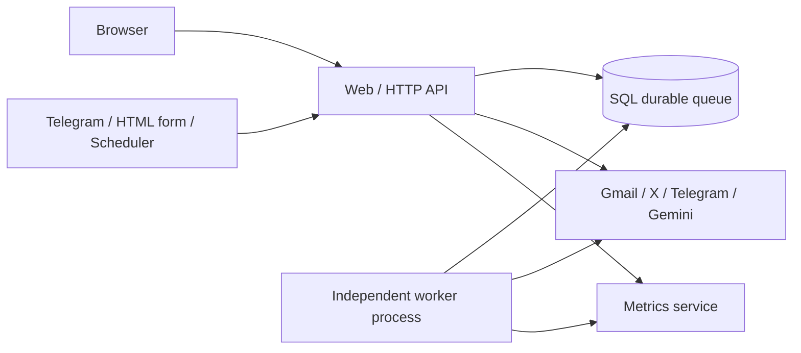

# m8m service architecture

The executable Docker topology in compose.yaml separates Web/API, Worker and optional MLflow services. compose.cloud.yaml runs the worker against hosted Turso. Vercel uses bounded event-driven execution instead of a permanent worker.

| Service | Contract | Ownership / recovery |
|---|---|---|
| Web/API | OpenAPI, owner-scoped sessions, signed forms, credential-authenticated hooks | Validation, immutable graphs, enqueue; queued jobs survive web restarts |
| Worker | SQL claim/lease/progress/finish, integration cursor state | Polling and DAG execution; atomic claims, heartbeat, expiry and explicit retry |
| MLflow | HTTP REST metrics | IDs/revision/duration/token totals; no payloads/prompts/secrets; failure isolated |
| Database | Transactions and unique event keys | Accounts, encryption, graph versions and idempotency; consistent backup with APP_SECRET |

Web and worker deploy and scale as separate processes but share domain modules and database ownership. This is a shared-database service architecture, **not a completed migration to independent bounded-context microservices**. A strict microservices requirement still needs agreed boundaries, separate stores, an outbox/event contract, credential delegation and reconciliation. That architectural migration is not claimed completed here; the current working free deployment and data are preserved.

Architecture decision: the user delegated this choice. Retain the existing service separation and shared transactional queue for this project; do not undertake an unnecessary independent-database migration or mislabel the topology as strict microservices.
